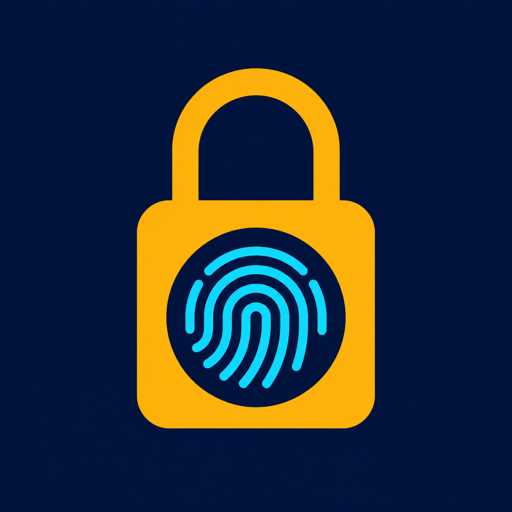

# Nimly Manager



Nimly Manager skal gi Home Assistant et bedre administrasjonslag for
Nimly-låser. Zigbee2MQTT er fortsatt transportlaget for den ordinære
lås-integrasjonen.

Repoet inneholder en Home Assistant custom integration med en egen,
mobilvennlig administrasjonsside, protokollkartlegging og forsiktige
støtteverktøy.

## Installer med HACS

Repoet må først være publisert offentlig som
`https://github.com/aridder/nimly-manager`. Deretter:

1. Åpne **HACS → Integrations**.
2. Åpne menyen og velg **Custom repositories**.
3. Legg inn `https://github.com/aridder/nimly-manager` som typen
   **Integration**.
4. Last ned **Nimly Manager** og start Home Assistant på nytt.
5. Gå til **Innstillinger → Enheter og tjenester → Legg til integrasjon** og
   velg **Nimly Manager**.

Ved oppdatering gjennom HACS må Home Assistant startes på nytt før ny backend
og panelside tas i bruk. Tøm eventuelt nettleserens hurtigbuffer hvis en gammel
panelside fortsatt vises.

Oppgi Zigbee2MQTTs base-topic, normalt `zigbee2mqtt`, og låsens eksakte
friendly name. Et komplett topic som `zigbee2mqtt/ytterdor` godtas også uten at
base-topicet legges til to ganger. MQTT-integrasjonen må allerede være
konfigurert i Home Assistant.

## Manuell installasjon

Kopier `custom_components/nimly_manager` til Home Assistants
`custom_components`-katalog og start Home Assistant på nytt. Legg deretter til
**Nimly Manager** under **Innstillinger → Enheter og tjenester**. Oppsettet spør
etter Zigbee2MQTT base-topic og låsens friendly name.

Integrasjonen abonnerer gjennom Home Assistants eksisterende MQTT-integrasjon.
Den åpner ikke en separat broker-forbindelse. Etter oppsett vises **Nimly
Manager** i Home Assistants sidepanel for administratorer.

## Fingeravtrykk i Nimly Manager

Åpne **Nimly Manager** i sidepanelet for å:

- se låsens MQTT-status og slots `003–199`
- velge en ukjent slot og navn på personen
- følge programmeringssekvensen ved den fysiske låsen
- bekrefte programmeringen og verifisere med en ekte opplåsing
- (eksperimentelt) starte skanningen fra Home Assistant over Bluetooth i
  stedet for masterfinger-sekvensen: importer eiernøkkelen under
  **Konfigurer**, velg BLE-slot 150–199, stå ved låsen, og legg fingeren på
  når panelet sier **NÅ**. Zigbee verifiserer som før.

Slotoversikten bruker tre bevisnivåer:

- **Verifisert**: Nimly Manager har fullført enrollment og sett riktig
  fingeravtrykk-slot ved opplåsing.
- **Observert**: sloten er sett brukt av låsen, men eieren er ukjent.
- **Ukjent**: ingen hendelse har bevist om sloten er opptatt eller ledig.

Zigbee2MQTT tilbyr ikke en komplett opplisting av fingeravtrykk-slots. Derfor
viser Nimly Manager aldri ukjente slots som «ledige». Velg bare en slot du vet
kan brukes. Kjente slots deaktiveres for ny enrollment.

Registreringen skjer fremdeles lokalt på låsen. Home Assistant mottar bare
slotnummer, navn og verifikasjonsstatus; biometri og masterfinger forlater aldri
låsen.

### Actions som reserveflyt

Den samme flyten kan ved behov styres gjennom Home Assistant-actions:

1. `nimly_manager.start_fingerprint_enrollment`
2. utfør trinnene som returneres av actionen
3. `nimly_manager.confirm_fingerprint_enrollment`
4. lås låsen og lås opp med den nye fingeren

`nimly_fingerprint_enrollment_verified` sendes bare etter en faktisk
låst-til-ulåst-overgang med fingerprint-kilde og forventet slot. En beholdt eller
gjentatt MQTT-state er ikke nok. Session-ID må brukes ved confirm og cancel, slik
at en gammel UI-handling ikke kan endre en nyere enrollment.

Rå MQTT-payloads lagres ikke. Feltet `last_used_pin_code` ignoreres og kommer
verken i event-data, lagret slot-metadata eller diagnostics.

## Utvikling og publisering

GitHub Actions kjører prosjektets tester, HACS-validatoren og Hassfest. Før en
GitHub Release må `version` i `manifest.json`, prosjektversjonen i
`pyproject.toml` og endringsloggen peke på samme versjon. Når versjonerte
releases brukes, krever HACS en full GitHub Release; en tag alene er ikke nok.

## Read-only BLE-probe

Proben finner Nimly-enheter som annonserer BLE-tjenesten `0xFD00`. Den skjuler
enhetsadresse og annonseringsdata som standard.

```bash
uv run --extra ble nimly-ble-probe scan
```

For å lese standardfeltet «Software Revision» fra én funnet enhet:

```bash
uv run --extra ble nimly-ble-probe inspect <probe-id>
```

`inspect` gjør bare GATT-lesing. Verktøyet har ingen kommandoer for å låse opp,
endre PIN/RFID, starte fingerprint-enrollment eller slette data.

Skriving til låsen bor i pakken `nimly_ble`
(`custom_components/nimly_manager/nimly_ble/`, levert med integrasjonen).
CLI-en `nimly-ble-owner` bruker den fra en laptop ved døra for `preflight`,
`enroll` (engangs eier-enrollment) og `fingerprint-scan`. Integrasjonen bruker
samme pakke over Home Assistants Bluetooth-integrasjon, så en ESPHome
`bluetooth_proxy` ved døra kan være transporten; se
[fingerprint-enrollment.md](docs/fingerprint-enrollment.md).

På macOS må Codex/terminalprosessen ha Bluetooth-tilgang. Låsen kan også måtte
vekkes fysisk før den annonserer.

Kjør testene med:

```bash
uv run --extra test pytest
```

Se [fingerprint-enrollment.md](docs/fingerprint-enrollment.md) for beslutning og
sikkerhetsgrenser.
